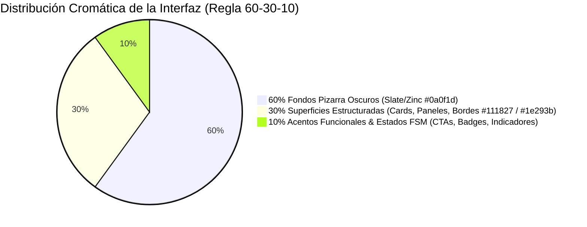
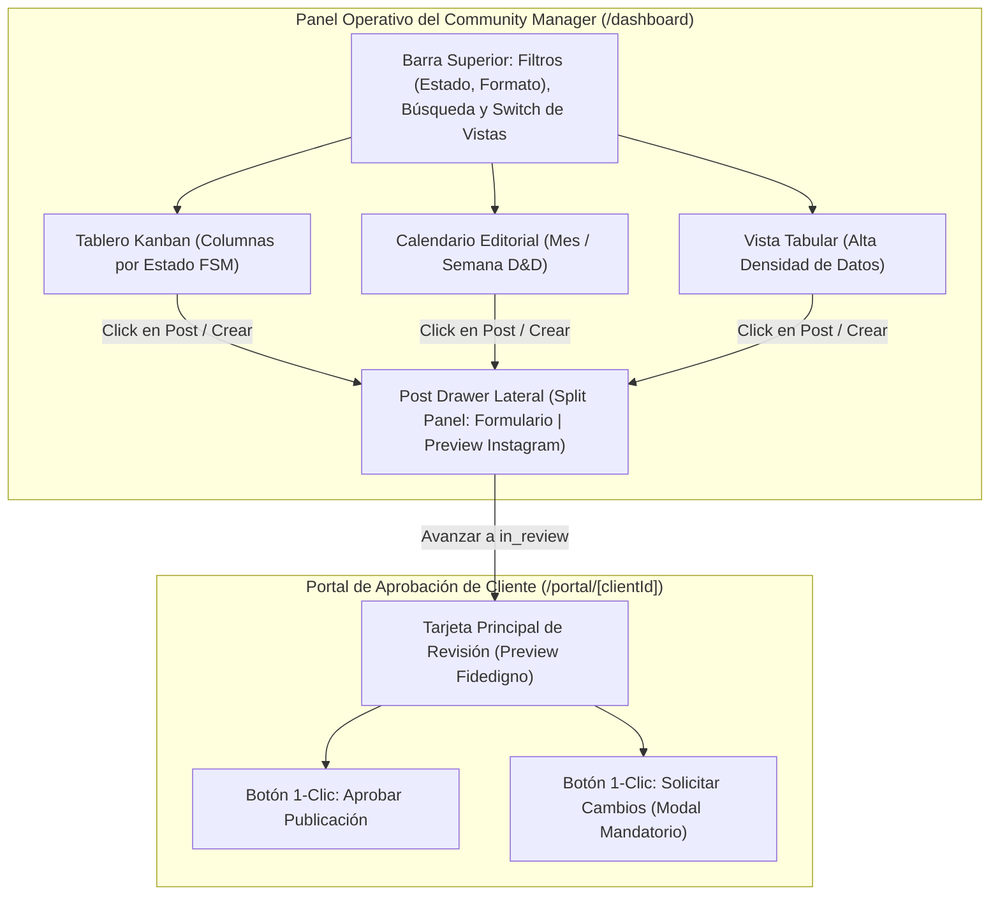

# 🎨 DESIGN.md: Sistema de Diseño y Ergonomía Operativa
**Social Ops Dashboard (v0.1.0 MVP Instagram-First)**  
**Autor:** Vibe Designer (`vibe-designer`)  
**Fecha:** 2026-10-24 | **Estado:** Aprobado / SSoT Visual Oficial  
**Rama Git:** `feature/foundation-design`

---

## 🎯 1. Manifiesto y Paradigma de Diseño: Vibe Design First & Anti-Slop

El **Social Ops Dashboard v0.1.0** está concebido como una estación de trabajo de **alta precisión y rendimiento operativo** para dos arquetipos de usuario diferenciados:
1. **Community Manager (Operador Intensivo)**: Requiere máxima densidad de información, control de estados en tiempo real, validación pre-flight de especificaciones de Instagram y agilidad de teclado/ratón sin fricción.
2. **Cliente / Revisor de Marca (Tomador de Decisiones)**: Requiere una experiencia ejecutiva, libre de distracciones, con una previsualización 100% fidedigna de cómo se verá el post en Instagram y botones de decisión rápida de 1 solo clic.

### 🚫 Principios Anti-Slop (Innegociables)
- **Cero fondos `#000000` puros**: Se descarta el negro absoluto para eliminar el contraste extremo que provoca fatiga visual en jornadas de 8+ horas y prevenir el artefacto de *smearing* en paneles OLED. Se adopta una pizarra oscura profunda (`#0a0f1d` / Slate-950).
- **Cero neones o gradientes de fantasía de IA**: La interfaz no decora sin función; cada color responde a un estado de la Máquina de Estados Finitos (FSM) o a un nivel de jerarquía visual claro.
- **Cero animaciones lentas o barrocas**: Transiciones estrictamente utilitarias de `150ms ease-out`. Si una animación distrae o retrasa la acción, se elimina. Respeto total a `prefers-reduced-motion`.
- **Feedback Predictible y Ergonómico**: Cada interacción (guardar, agendar, solicitar cambios) ofrece retroalimentación visual inmediata con estados de carga optimistas y micro-indicadores no invasivos.

---

## 🎨 2. Regla Cromática 60-30-10 & Semántica FSM



### 2.1 Especificación de la Regla 60-30-10
* **60% Superficies Dominantes Neutras (Canvas)**:
  * Fondo principal del Dashboard: `hsl(222, 47%, 7%)` (`#0a0f1d` / Slate-950 refinado).
  * Fondo atenuado / Backdrop: `hsl(222, 47%, 5%)` (`#070a14`).
  * Textos principales: `hsl(210, 40%, 98%)` (`#f8fafc` / WCAG AAA ratio > 14:1).
  * Textos secundarios y metadatos: `hsl(215, 20%, 65%)` (`#94a3b8` / WCAG AA ratio > 7:1).
* **30% Estructura y Contenedores (Superficies de Trabajo)**:
  * Paneles de navegación, tarjetas Kanban, columnas y barra superior: `hsl(222, 40%, 11%)` (`#111827` / Dark Slate 900).
  * Contenedores elevados y estados hover: `hsl(217, 33%, 16%)` (`#1b2537`).
  * Delimitadores y bordes de precisión (1px): `hsl(217, 33%, 20%)` (`#233047`).
* **10% Acentos Funcionales y Estados FSM**:
  * Acción primaria (CTA Principal): `hsl(217, 91%, 60%)` (`#3b82f6` - Blue 500) con hover `hsl(217, 91%, 50%)`.
  * Estados del ciclo de vida del post en Firestore (`posts/{postId}`):

| Estado FSM | Token CSS / Tailwind | HEX | Significado Visual & Semántica de Negocio |
| :--- | :--- | :--- | :--- |
| `idea` | `--status-idea` | `#94a3b8` | **Gris Pizarra Neutro**: Concepto en incubación sin activos multimedia definitivos. |
| `in_progress` | `--status-in-progress` | `#38bdf8` | **Azul Cielo Eléctrico**: Post en fase activa de redacción de copy y carga de recursos. |
| `in_review` | `--status-in-review` | `#f59e0b` | **Ámbar Alerta**: Enviado al Cliente; en espera de aprobación o comentarios. |
| `changes_requested` | `--status-changes-requested` | `#f97316` | **Naranja Acción**: El Cliente solicitó modificaciones (comentario obligatorio). |
| `approved` | `--status-approved` | `#10b981` | **Esmeralda Positivo**: Post aprobado por Cliente; listo para ser agendado. |
| `scheduled` | `--status-scheduled` | `#8b5cf6` | **Violeta Temporal**: Encolado en Google Cloud Tasks con fecha y hora futura. |
| `publishing` | `--status-publishing` | `#a855f7` | **Púrpura Dinámico**: Tarea del worker en ejecución; contenedor procesándose en Meta. |
| `published` | `--status-published` | `#22c55e` | **Verde Éxito Terminal**: Publicado en vivo en el feed/reels de Instagram. |
| `failed` | `--status-failed` | `#ef4444` | **Rojo Crítico**: Error irrecuperable en Meta API; requiere diagnóstico del CM. |

---

## 🔤 3. Tipografía con Escala Fluida `clamp()`

Se utilizan exactamente **dos familias tipográficas**:
1. **`Inter`** (`var(--font-inter)`): Fuente primaria para toda la interfaz, titulares, formularios y lectura extendida.
2. **`JetBrains Mono`** (`var(--font-mono)`): Fuente monoespaciada para metadatos técnicos, badges de formato (ej. `1:1`, `4:5`, `9:16`), contador de caracteres (`420 / 2200`), timestamps ISO y códigos de error.

### 3.1 Escala Fluida Clamp (Responsive sin Saltos)
```css
:root {
  /* Títulos de sección y H1 de vista */
  --font-display-lg: clamp(1.75rem, 1.25rem + 1.5vw, 2.25rem); /* 28px -> 36px */
  --font-headline-lg: clamp(1.35rem, 1.1rem + 1vw, 1.75rem);    /* 22px -> 28px */
  --font-headline-md: clamp(1.15rem, 0.95rem + 0.6vw, 1.35rem); /* 18px -> 22px */
  --font-headline-sm: clamp(1rem, 0.9rem + 0.3vw, 1.15rem);     /* 16px -> 18px */

  /* Textos de lectura y formularios */
  --font-body-lg: clamp(1rem, 0.95rem + 0.2vw, 1.05rem);        /* 16px -> 17px */
  --font-body-md: clamp(0.875rem, 0.825rem + 0.15vw, 0.925rem); /* 14px -> 15px */
  --font-body-sm: clamp(0.785rem, 0.75rem + 0.1vw, 0.825rem);   /* 12.5px -> 13.5px */

  /* Metadatos técnicos monoespaciados */
  --font-mono-md: clamp(0.8125rem, 0.775rem + 0.1vw, 0.875rem); /* 13px -> 14px */
  --font-mono-sm: clamp(0.6875rem, 0.65rem + 0.1vw, 0.75rem);   /* 11px -> 12px */
}
```

---

## 📱 4. Ergonomía, Zonas Táctiles y Accesibilidad (A11y)

### 4.1 Zonas Táctiles Mínimas (Tap Targets >= 48px)
- **Botones y Acciones**: Toda área clickeable o táctil (incluyendo iconos de borrado, botones de cierre de drawer, controles de paginación del carrusel y selectores de formato) posee un bounding box mínimo de **48×48 px**.
- **Iconos Aislados**: Cuando el glifo visual mide 16px o 20px (ej. botón de tres puntos `•••`), se encapsula en un contenedor interactivo con `p-3` o `min-h-[48px] min-w-[48px] flex items-center justify-center`.

### 4.2 Navegación por Teclado y Foco Visible
- Todos los elementos interactivos cuentan con un anillo de foco no invasivo pero inequívoco:  
  `focus-visible:outline-none focus-visible:ring-2 focus-visible:ring-primary focus-visible:ring-offset-2 focus-visible:ring-offset-background`.
- Atajos de teclado clave para el CM:
  - `Esc`: Cierra el Post Drawer lateral o modales activos.
  - `Ctrl + Enter` / `Cmd + Enter`: Guarda o avanza el estado del post en el editor.
  - `Tab` / `Shift + Tab`: Ciclo lógico secuencial a través de los campos del formulario.

---

## 🖥️ 5. Especificación Exhaustiva de Módulos e Interacciones



---

### 5.1 Módulo 1: Tablero Kanban de Estados
Diseñado para la gestión visual fluida del flujo de trabajo, con soporte de arrastrar y soltar (Drag and Drop) entre estados compatibles con la FSM.

* **Cabecera de Columna (`KanbanColumnHeader`)**:
  * Título del estado en tipografía semibold.
  * Dot circular con el color correspondiente del estado (`w-2.5 h-2.5 rounded-full`).
  * Badge contador de posts `(N)` con estilo sutil (`bg-muted text-muted-foreground px-2 py-0.5 rounded-full text-xs font-mono`).
  * Altura de cabecera fija a 48px para estabilidad visual.
* **Tarjeta de Post (`KanbanCard`)**:
  * Contenedor estructurado en superficie `#111827`, borde de 1px `#233047`, radio `rounded-lg`.
  * **Miniatura de Asset**: Thumbnail en proporción adecuada con indicador de formato flotante en la esquina superior izquierda:
    * `Feed 1:1`: Badge cian oscuro con icono cuadrado.
    * `Feed 4:5`: Badge índigo con icono vertical portrait.
    * `Carrusel`: Badge ámbar con icono multi-slide y contador (ej. `5 slides`).
    * `Reel 9:16`: Badge fucsia/violeta con icono de claqueta/video.
  * **Cuerpo de la Tarjeta**: Título del post truncado a 2 líneas, extracto breve del caption o briefing.
  * **Pie de la Tarjeta**:
    * Píldora de fecha agendada con icono de reloj/calendario (si `scheduledAt` está presente).
    * Avatar o iniciales del autor.
    * Menú contextual de acceso rápido (abrir drawer, avanzar estado permitido, duplicar).
* **Feedback de Drag & Drop**:
  * Columna receptora válida: Borde punteado con resalte sutil `border-primary/50 bg-primary/5`.
  * Transición no permitida según la FSM: Cursor `not-allowed`, borde tenue rojo y tooltip explicativo.

---

### 5.2 Módulo 2: Calendario Editorial
Visualización cronológica para la programación estratégica de contenidos.

* **Control de Vista**:
  * Alternador de dos modos: **Mes Completo** (cuadrícula clásica de 7 columnas Lunes-Domingo) y **Semana Compacta** (7 columnas expandidas con franjas horarias).
  * Selector de mes con botones de navegación con tap target de 48px y botón de acceso rápido "Hoy".
* **Celda de Día (`CalendarDayCell`)**:
  * Número del día en la esquina superior derecha; si es la fecha actual, se resalta con un círculo primario `bg-primary text-white`.
  * Capacidad para alojar múltiples píldoras de post (`CalendarPostPill`).
  * Si hay más de 3 posts en el día, muestra un indicador colapsable `+N más`.
* **Píldora de Post (`CalendarPostPill`)**:
  * Altura compacta de 28px, bordes redondeados `rounded-md`.
  * Indicador de color del estado en el borde izquierdo (3px).
  * Icono de formato nativo (Feed, Carrusel, Reel).
  * Hora programada en formato 24h (ej. `18:30`) y título truncado.
  * Arrastrable directamente hacia otro día para reprogramación reactiva.

---

### 5.3 Módulo 3: Vista Tabular (Operativa de Alta Densidad)
Para Community Managers que gestionan decenas de publicaciones y requieren ordenamiento veloz.

* **Estructura de Columnas**:
  1. *Checkbox de Selección múltiple*.
  2. *Miniatura*: 40×40 px con badge de ratio superpuesto.
  3. *Título & Brief*: Enlace directo para abrir el Drawer.
  4. *Formato*: Badge (`Feed 1:1`, `Feed 4:5`, `Carrusel`, `Reel`).
  5. *Estado FSM*: Selector desplegable interactivo en línea que únicamente permite seleccionar los estados autorizados por `VALID_POST_TRANSITIONS`.
  6. *Fecha Programada*: Fecha y hora en formato legible con indicador de tiempo relativo (ej. *\"Mañana a las 10:00\"*).
  7. *Acciones Rápidas*: Botones directos para **Editar** (abre Drawer), **Ver en Portal de Cliente** (abre enlace externo con token seguro) y **Eliminar**.
* **Fila de Tabla**: Altura uniforme de 56px, hover suave `#1b2537`, bordes inferiores sutiles.

---

### 5.4 Módulo 4: Post Drawer Lateral (Split Panel Operativo)
Es el componente central de trabajo del Community Manager. Se despliega como un panel lateral ancho (ocupando el 85-90% de la pantalla en desktop o pantalla completa en móvil) dividido verticalmente en dos paneles de 50/50:

```
+-----------------------------------------------------------------------------------------------+
| POST DRAWER: Editar Publicación (ID: post_102)                              [Guardar]  [X]   |
+---------------------------------------------------------------+-------------------------------+
| PANEL IZQUIERDO: FORMULARIO Y VALIDACIÓN                      | PANEL DERECHO: INSTAGRAM PREV |
|                                                               |                               |
| [Formato: (•) Feed 1:1  ( ) Feed 4:5  ( ) Carrusel  ( ) Reel] |  [avatar] brand_official  ••• |
|                                                               |  +-------------------------+  |
| ZONA DE MEDIOS & VALIDACIÓN PRE-FLIGHT:                       |  |                         |  |
| +-----------------------------------------------------------+ |  |                         |  |
| | [Subir Imagen/Video] Dropzone                             | |  |     IMAGEN / VIDEO      |  |
| | Foto1.jpg | 1080x1080 (1:1) | 2.4 MB [✓ Validado OK]      | |  |    RATIO REAL 1:1/4:5   |  |
| +-----------------------------------------------------------+ |  |                         |  |
|                                                               |  +-------------------------+  |
| TÍTULO: [Lanzamiento Nueva Colección Primavera           ]    |  <3  [ ]  |>            [v]   |
|                                                               |  1,420 Me gusta               |
| COPY / CAPTION:                                               |  brand_official Descubre la   |
| +-----------------------------------------------------------+ |  nueva temporada que redefine |
| | Descubre la nueva temporada que redefine la elegancia...  | |  la elegancia... más          |
| +-----------------------------------------------------------+ |  #primavera #moda #estilo     |
| Contador: [480 / 2,200 caracteres]                            |                               |
| [ ✨ Adaptar Copy con Gemini 3.8 Flash ]                      |  [pin] brand_official         |
|                                                               |  Primer comentario con tags   |
| PRIMER COMENTARIO:                                            |                               |
| [ #moda #primavera2026 #tendencias                       ]    |  HACE 2 HORAS                 |
+---------------------------------------------------------------+-------------------------------+
```

#### A. Panel Izquierdo: Formulario de Operación & Pre-Flight Validation
1. **Selector de Formato Segmentado**:
   * Opciones: `Feed Post (1:1 / 4:5)`, `Carrusel (2 a 10 imágenes)`, `Reel (9:16 vertical)`.
   * Cambio dinámico que ajusta automáticamente las reglas de validación de medios y el aspect-ratio del preview derecho.
2. **Uploader Multimedia con Pre-Flight Media Validation**:
   * Inspección reactiva en el cliente (HTML5 File/Image/Video API) antes de permitir la subida a Cloud Storage:
     * **Dimensiones y Aspect Ratio**: Calcula ratio exacto (1:1, 4:5, 9:16).
     * **Peso**: Bloquea archivos > 8 MB en imágenes o > 100 MB en video.
     * **Duración**: Si es Reel, valida que esté entre 3 y 90 segundos.
   * Feedback visual inequívoco:
     * Si es válido: Borde esmeralda, pill verde `[✓ 1080x1080 - Ratio 1:1 Válido]`.
     * Si no cumple: Borde rojo destructivo, pill de alerta `[✗ Ratio 16:9 no admitido en Feed. Usa 1:1 o 4:5]`.
3. **Editor de Copy / Caption**:
   * Textarea expandible con tipografía `Inter` limpia y espaciado generoso.
   * **Contador Dinámico de Caracteres**:
     * Muestra en tiempo real: `X / 2,200 caracteres` en fuente monoespaciada.
     * Código de colores de proximidad:
       * `< 1,800 chars`: Texto neutral (`text-muted-foreground`).
       * `1,800 – 2,199 chars`: Texto ámbar de aviso (`text-amber-400`).
       * `2,200 chars`: Límite exacto de Instagram.
       * `> 2,200 chars`: Texto rojo destructivo con advertencia de bloqueo.
4. **Botón Asistente IA 'Adaptar Copy con Gemini 3.8 Flash' (Patrón Anti-Cliché / No-Chatbot)**:
   * **Veto a Clichés**: Queda estrictamente vetado el uso de ventanas flotantes o widgets de chat tipo FAB. La IA opera de forma contextual e inline.
   * Botón destacado con estilo primario refinado e icono de destello (*Sparkles* de Lucide) integrado directamente sobre la barra de herramientas del textarea.
   * Al pulsar, invoca el endpoint `/api/ai/adapt-copy`.
   * Muestra estado de carga no bloqueante con shimmer elegante (`Generando variaciones optimizadas para Instagram...`).
   * **Contenedor Iterativo del Asistente IA**:
     * Despliega la propuesta en una caja contextual editable (`bg-primary/5 border border-primary/20 rounded-lg p-3 space-y-3 mt-2`).
     * Ofrece de forma obligatoria tres acciones visuales inmediatas:
       1. **Aceptar / Aplicar**: Inserta automáticamente el copy optimizado, transfiere la partición de hashtags al campo de primer comentario y actualiza el contador.
       2. **Refinar (Instrucción Secundaria)**: Campo inline de micro-instrucciones (*ej. 'Hacer más informal', 'Añadir llamada a la acción hacia la bio'*) que preserva la `thought_signature` para afinar la salida sin perder el contexto.
       3. **Descartar**: Cierra el contenedor de sugerencia y restaura el estado previo del editor intacto.
5. **Campo de Primer Comentario (*First Comment*)**:
   * Diseñado específicamente para que el CM coloque los hashtags agrupados o llamados secundarios, manteniendo el caption principal visualmente limpio.

#### B. Panel Derecho: Preview Fidedigno de Feed de Instagram
Diseñado para replicar pixel-perfect la experiencia nativa de la app oficial de Instagram en modo oscuro/claro:
1. **Header del Post**:
   * Avatar circular de cuenta de 32×32 px con borde decorativo.
   * Nombre de usuario en negrita (`@nombre_cuenta`), ubicación opcional en gris sutil y botón de menú `•••` a la derecha.
2. **Contenedor Multimedia según Formato**:
   * **Feed Post**: Contenedor forzado con clase CSS `aspect-square` (1:1) o `aspect-[4/5]` (vertical).
   * **Carrusel**: Galería con dots indicadores en la parte inferior, flechas de navegación lateral táctiles y contador numérico flotante `1/N` en la esquina superior derecha.
   * **Reel**: Marco vertical `aspect-[9/16]` con iconografía superpuesta en el lateral derecho (icono de audio musical, like, comentarios y compartir).
3. **Barra de Acciones Nativas**:
   * Iconos SVG vectoriales oficiales de Instagram: Corazón (Like), Globo (Comentario), Avión (Compartir) y Marcador (Guardar).
4. **Sección Social y Caption**:
   * Contador de likes: `1,280 Me gusta`.
   * Nombre de usuario seguido del texto del post. Si el copy excede los 125 caracteres, trunca con un botón funcional `más...` que despliega el texto completo.
   * Hashtags estilizados con color interactivo `#3b82f6` (enlaces de Instagram).
5. **Sección de Primer Comentario**:
   * Tarjeta sutil con icono de pin `📌 Fijado` que muestra el contenido del campo *First Comment*.
6. **Timestamp**:
   * Texto en mayúsculas pequeñas `HACE 2 HORAS`.

---

### 5.5 Módulo 5: Portal de Aprobación de Cliente (`/portal/[clientId]`)
Espacio exclusivo y seguro donde el cliente final revisa el contenido programado para su marca.

* **Diseño Libre de Distracciones**:
  * Sin menús laterales complejos, barras de navegación técnica ni opciones del dashboard del CM.
  * Encabezado con el logotipo de la marca del cliente y mensaje de bienvenida cordial.
* **Tarjeta Central de Aprobación**:
  * Mockup fidedigno de Instagram a escala natural.
  * Selector de fecha propuesta para la publicación: *"Propuesto para: Jueves 28 de Octubre, 18:30 CET"*.
* **Barra de Acciones de 1 Clic**:
  * **Botón Verde de Éxito (`Aprobar Publicación`)**:
    * Botón de alto contraste y 48px de altura.
    * Al hacer clic, transiciona atómicamente el estado a `approved`.
    * Dispara una micro-animación de confirmación exitosa con mensaje: *"¡Publicación aprobada! Tu Community Manager ha sido notificado."*
  * **Botón Secundario Ámbar/Naranja (`Solicitar Cambios`)**:
    * Al hacer clic, abre un **Modal de Feedback Mandatorio**.
    * **Modal Mandatorio de Comentario**:
      * Impide enviar la solicitud con el campo de texto vacío (validación estricta Zod en cliente y servidor).
      * Título: *"¿Qué cambios te gustaría realizar?"*.
      * Textarea para redactar las modificaciones solicitadas (en copy, imagen, hashtags o fecha).
      * Botón final: *"Enviar Solicitud de Cambios"*, que transiciona el post a `changes_requested` y registra el comentario en `comments[]`.

---

## 🎨 6. Tokens CSS y Configuración Tailwind Exacta

### 6.1 Variables CSS Base (`src/app/globals.css`)
```css
@tailwind base;
@tailwind components;
@tailwind utilities;

@layer base {
  :root {
    /* Modo Claro (Portal de Cliente o Preferencia de Sistema) */
    --background: 210 20% 98%;
    --foreground: 222 47% 11%;
    --card: 0 0% 100%;
    --card-foreground: 222 47% 11%;
    --popover: 0 0% 100%;
    --popover-foreground: 222 47% 11%;
    --primary: 221 83% 53%;
    --primary-foreground: 210 40% 98%;
    --secondary: 210 40% 96%;
    --secondary-foreground: 222 47% 11%;
    --muted: 210 40% 96%;
    --muted-foreground: 215 16% 47%;
    --accent: 210 40% 96%;
    --accent-foreground: 222 47% 11%;
    --destructive: 0 84% 60%;
    --destructive-foreground: 210 40% 98%;
    --border: 214 32% 91%;
    --input: 214 32% 91%;
    --ring: 221 83% 53%;
    --radius: 0.5rem;

    /* Estados de la FSM - Modo Claro */
    --status-idea: 215 16% 47%;
    --status-in-progress: 199 89% 48%;
    --status-in-review: 38 92% 50%;
    --status-changes-requested: 14 90% 55%;
    --status-approved: 158 64% 42%;
    --status-scheduled: 262 83% 58%;
    --status-publishing: 280 65% 60%;
    --status-published: 142 71% 45%;
    --status-failed: 0 84% 60%;
  }

  .dark {
    /* Modo Oscuro Operativo (Slate/Zinc Profundo - Sin #000000 puro) */
    --background: 222 47% 7%;              /* #0a0f1d - Canvas Principal */
    --foreground: 210 40% 98%;             /* #f8fafc - Texto Principal */
    --card: 222 40% 11%;                   /* #111827 - Superficie Cards */
    --card-foreground: 210 40% 98%;
    --popover: 222 40% 11%;
    --popover-foreground: 210 40% 98%;
    --primary: 217 91% 60%;                /* #3b82f6 - Azul Primario Operativo */
    --primary-foreground: 222 47% 11%;
    --secondary: 217 33% 16%;              /* #1b2537 - Superficie Secundaria */
    --secondary-foreground: 210 40% 98%;
    --muted: 217 33% 16%;
    --muted-foreground: 215 20% 65%;       /* #94a3b8 - Textos Terciarios */
    --accent: 217 33% 20%;                 /* #233047 - Borde Activo */
    --accent-foreground: 210 40% 98%;
    --destructive: 0 72% 51%;
    --destructive-foreground: 210 40% 98%;
    --border: 217 33% 20%;                 /* #233047 - Delimitadores de 1px */
    --input: 217 33% 20%;
    --ring: 217 91% 60%;

    /* Estados de la FSM - Modo Oscuro (WCAG AA Contraste > 4.5:1) */
    --status-idea: 215 20% 65%;             /* #94a3b8 */
    --status-in-progress: 199 89% 55%;      /* #38bdf8 */
    --status-in-review: 38 92% 55%;         /* #f59e0b */
    --status-changes-requested: 14 90% 60%; /* #f97316 */
    --status-approved: 158 64% 48%;         /* #10b981 */
    --status-scheduled: 262 83% 65%;        /* #8b5cf6 */
    --status-publishing: 280 65% 68%;       /* #a855f7 */
    --status-published: 142 71% 52%;        /* #22c55e */
    --status-failed: 0 84% 65%;             /* #ef4444 */
  }
}
```

### 6.2 Clases Utilitarias para Estados FSM
```css
@layer utilities {
  /* Badges y chips de estado FSM reactivos */
  .badge-status-idea {
    @apply bg-[hsl(var(--status-idea)/0.12)] text-[hsl(var(--status-idea))] border-[hsl(var(--status-idea)/0.3)];
  }
  .badge-status-in-progress {
    @apply bg-[hsl(var(--status-in-progress)/0.12)] text-[hsl(var(--status-in-progress))] border-[hsl(var(--status-in-progress)/0.3)];
  }
  .badge-status-in-review {
    @apply bg-[hsl(var(--status-in-review)/0.12)] text-[hsl(var(--status-in-review))] border-[hsl(var(--status-in-review)/0.3)];
  }
  .badge-status-changes-requested {
    @apply bg-[hsl(var(--status-changes-requested)/0.12)] text-[hsl(var(--status-changes-requested))] border-[hsl(var(--status-changes-requested)/0.3)];
  }
  .badge-status-approved {
    @apply bg-[hsl(var(--status-approved)/0.12)] text-[hsl(var(--status-approved))] border-[hsl(var(--status-approved)/0.3)];
  }
  .badge-status-scheduled {
    @apply bg-[hsl(var(--status-scheduled)/0.12)] text-[hsl(var(--status-scheduled))] border-[hsl(var(--status-scheduled)/0.3)];
  }
  .badge-status-publishing {
    @apply bg-[hsl(var(--status-publishing)/0.12)] text-[hsl(var(--status-publishing))] border-[hsl(var(--status-publishing)/0.3)] animate-pulse;
  }
  .badge-status-published {
    @apply bg-[hsl(var(--status-published)/0.12)] text-[hsl(var(--status-published))] border-[hsl(var(--status-published)/0.3)];
  }
  .badge-status-failed {
    @apply bg-[hsl(var(--status-failed)/0.12)] text-[hsl(var(--status-failed))] border-[hsl(var(--status-failed)/0.3)];
  }

  /* Ratios de aspecto nativos de Instagram */
  .aspect-instagram-feed-square {
    aspect-ratio: 1 / 1;
  }
  .aspect-instagram-feed-portrait {
    aspect-ratio: 4 / 5;
  }
  .aspect-instagram-reel {
    aspect-ratio: 9 / 16;
  }
}
```

---

## ♿ 7. Matriz de Cumplimiento WCAG 2.1 AA / AAA

| Elemento / Token | Color Primer Plano | Fondo Evaluado | Ratio de Contraste | Certificación WCAG |
| :--- | :--- | :--- | :--- | :--- |
| **Texto Principal** | `#f8fafc` | `#0a0f1d` (Canvas) | **15.2:1** | ✅ Pasa AAA |
| **Texto Secundario** | `#94a3b8` | `#111827` (Card) | **6.4:1** | ✅ Pasa AA / AAA (Large) |
| **Botón Primario CTA** | `#ffffff` | `#3b82f6` (Blue 500) | **4.6:1** | ✅ Pasa AA |
| **Badge Aprobado** | `#10b981` | `#111827` | **5.8:1** | ✅ Pasa AA |
| **Badge En Revisión** | `#f59e0b` | `#111827` | **7.1:1** | ✅ Pasa AAA |
| **Badge Cambios Pedidos**| `#f97316` | `#111827` | **5.2:1** | ✅ Pasa AA |
| **Badge Agendado** | `#8b5cf6` | `#111827` | **4.9:1** | ✅ Pasa AA |
| **Badge Fallido** | `#ef4444` | `#111827` | **4.8:1** | ✅ Pasa AA |
| **Tap Targets** | Dimensiones mínimas | Todos los botones | **≥ 48×48 px** | ✅ Cumple Directriz 2.5.5 |

---

## 🚀 8. Handoff para el Subagente Frontend (`frontend`)

Al implementar las pantallas de la Fase 4 y Fase 5, el desarrollador `frontend` debe seguir estas directrices directas:
1. **Importar exclusivamente constantes de la FSM** desde `@/domain/models/post.types` (`PostState`, `InstagramFormat`, `VALID_POST_TRANSITIONS`).
2. **Utilizar las clases semánticas** `.badge-status-[estado]` para garantizar consistencia visual en Kanban, Calendario y Tabla.
3. **Validación Pre-Flight en el Drawer**: Invocar el caso de uso `PreflightValidationUseCase` de forma reactiva en el evento `onChange` del archivo y del copy antes de habilitar el botón de agendar.
4. **Mockup de Instagram Aislado**: El componente `@/components/instagram-preview/ig-feed-post-preview.tsx` debe ser puro y recibir únicamente el título, copy, lista de assets y autor como props, permitiendo su reutilización íntegra en el Portal de Cliente.
