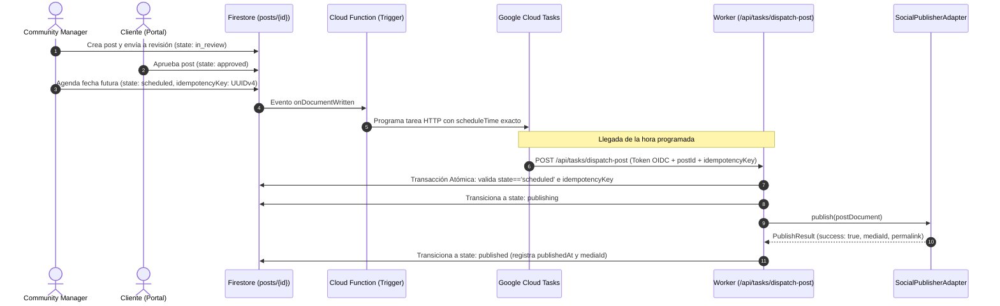

# ADR-0001: SSoT en Firestore, FSM Transaccional, Despacho por Cloud Tasks y SocialPublisherAdapter Desacoplado

- **Identificador:** ADR-0001
- **Fecha:** 2026-10-24
- **Estado:** Aprobado (Approved)
- **Decisores:** Principal Software Architect (`software-architect`), Tech Lead (`@webapp`), Product Director (`@CEO`)
- **Alcance:** Social Ops Dashboard (v0.1.0 MVP Instagram-First)

---

## 📋 1. Contexto y Planteamiento del Problema

En las operaciones de agencias y Community Managers (CMs), el ciclo de vida de un post atraviesa múltiples etapas críticas: ideación, redacción de copy y guiones, diseño de medios, revisión y aprobación por el cliente final, agendamiento y publicación automática en redes sociales.

Los sistemas tradicionales suelen adolecer de fallas operativas graves:
1. **Doble Publicación (*Double Publishing*):** Reintentos automáticos no sincronizados o condiciones de carrera (*race conditions*) que provocan la publicación reiterada del mismo post, dañando la reputación de la marca.
2. **Desincronización y Estados Zombi:** El cliente solicita cambios mientras el post ya fue enviado a una cola de despacho, o el CM edita una imagen pero se publica la versión desactualizada.
3. **Acoplamiento Directo con APIs Externas:** El backend invoca directamente SDKs de terceros (Meta Graph API). Ante fallas de red, caídas de Meta o cambios en la API, la aplicación colapsa y no es posible realizar pruebas locales ni CI/CD deterministas sin credenciales reales.
4. **Costo de Servidores Dedicados:** El uso de workers o servidores 24/7 (como Redis/BullMQ o Celery) genera costos fijos injustificados para agencias con volúmenes intermitentes de publicaciones.

---

## 🎯 2. Drivers de Decisión (Fuerzas Arquitecturales)

- **Idempotencia Transaccional Absoluta:** Garantía matemática de que ningún post se publicará más de una vez, incluso ante desconexiones de red o reintentos de cola.
- **Sincronización en Tiempo Real (SSoT):** Feedback instantáneo para CM y Cliente sin recargar la página cuando se aprueba, rechaza o programa un contenido.
- **Arquitectura Desacoplada (Hexagonal / Ports & Adapters):** Aislamiento total de las APIs de redes sociales, permitiendo desarrollo local con proveedores simulados y extensión natural a nuevas redes (TikTok, LinkedIn, X en v0.2.0+).
- **Eficiencia de Costes (Serverless Pay-per-Use):** Cero coste computacional en reposo; ejecución puntual y precisa al segundo programado.

---

## ⚖️ 3. Opciones Evaluadas

### Opción 1: Base de Datos Relacional (PostgreSQL) + Servidor Persistente con Redis/BullMQ
- *Pros:* Transacciones ACID estándar, ecosistema maduro de colas.
- *Contras:* Servidor dedicado 24/7 con coste fijo continuo; carece de suscripciones reactivas en tiempo real nativas hacia el navegador; mayor mantenimiento operativo.

### Opción 2: Polling Periódico por Minuto (Cron Job / Cloud Scheduler + Firestore)
- *Pros:* Implementación conceptualmente sencilla.
- *Contras:* Latencia de hasta 60 segundos; escaneo constante de la base de datos (lecturas innecesarias en Firestore con coste incremental); alta probabilidad de contención en picos horarios.

### Opción 3 (Seleccionada): SSoT en Firestore + FSM Formal + Google Cloud Tasks + SocialPublisherAdapter
- *Pros:*
  - Despacho con precisión de un segundo sin incurrir en polling.
  - Cancelación nativa de tareas al des-agendar o editar un post (`tasksClient.deleteTask`).
  - Seguridad OIDC de nivel empresarial en la invocación del worker.
  - Cero coste de cómputo en periodos de inactividad.
  - Testabilidad al 100% mediante el adaptador simulado `MockPublisherProvider`.
- *Contras:* Dependencia del ecosistema Google Cloud / Firebase; requiere disciplina en la gestión de tokens y emulación local.

---

## 💡 4. Decisión Arquitectural

Se aprueba formalmente la adopción de la **Opción 3** para el núcleo operativo de Social Ops Dashboard v0.1.0:



### 4.1 Máquina de Estados Finitos (FSM)
Los estados se limitan a: `idea`, `in_progress`, `in_review`, `changes_requested`, `approved`, `scheduled`, `publishing`, `published`, `failed`.
- Ningún post puede transicionar a `scheduled` sin haber alcanzado previamente el estado `approved` y superado la validación pre-flight de medios y copy.
- Si un post en `scheduled` es editado o reprogramado, la FSM cancela la tarea asociada en Cloud Tasks y transiciona a `in_progress` o genera un nuevo `idempotencyKey`.

### 4.2 Idempotencia y Transacción de Despacho
1. En cada agendamiento se genera un `idempotencyKey` (UUIDv4) almacenado en el documento `posts/{postId}`.
2. La tarea en Cloud Tasks lleva como payload `{ postId, idempotencyKey }`.
3. Al recibir la invocación, el endpoint `/api/tasks/dispatch-post`:
   - Valida la firma del token OIDC emitido por Google Cloud Tasks.
   - Ejecuta una **transacción atómica en Firestore**:
     ```typescript
     // Pseudocódigo del cerrojo de despacho
     await firestore.runTransaction(async (transaction) => {
       const postRef = firestore.collection('posts').doc(postId);
       const snapshot = await transaction.get(postRef);
       const post = snapshot.data();

       if (post.state !== 'scheduled' || post.idempotencyKey !== incomingIdempotencyKey) {
         throw new StaleTaskExecutionError('Tarea obsoleta o ya despachada.');
       }

       transaction.update(postRef, {
         state: 'publishing',
         updatedAt: new Date().toISOString()
       });
     });
     ```
   - Si la verificación falla (por ejemplo, porque el post fue reprogramado y la tarea vieja se ejecutó por un desfase de red), la petición se descarta de inmediato con HTTP 200 sin invocar la red social.

### 4.3 Puerto Desacoplado: `SocialPublisherAdapter`
- La lógica de aplicación solo conoce la interfaz `SocialPublisherAdapter`.
- En v0.1.0 se provee `InstagramGraphAdapter` para producción y `MockPublisherProvider` para entornos de desarrollo y suites de pruebas automatizadas.
- En v0.2.0+, la incorporación de TikTok, LinkedIn o X se realizará añadiendo nuevas implementaciones del puerto sin alterar los casos de uso ni la FSM.

### 4.4 Mitigación de Fallos y Política de Reintentos
- **Fallos Transitorios de Red (HTTP 429 / 5xx en API de Meta):**  
  El worker retorna código HTTP 503 a Cloud Tasks. Cloud Tasks reintenta automáticamente con retroceso exponencial (*exponential backoff*).
- **Fallos Irrecuperables (Token de Meta revocado, medios corruptos rechazados por Instagram):**  
  El worker transiciona el post a `failed` en Firestore, registra el detalle en `publishResult.error` y retorna HTTP 200 a Cloud Tasks para finalizar el ciclo de reintentos y notificar al CM.

---

## 📊 5. Consecuencias y Trade-Offs

### Consecuencias Positivas:
1. **Eliminación del Riesgo de Doble Publicación:** El cerrojo transaccional en Firestore y el `idempotencyKey` impiden colisiones concurrentes.
2. **Experiencia Reactiva Inmediata:** La SSoT en Firestore permite a clientes y CMs colaborar en tiempo real sin recargar la página.
3. **Desacoplamiento Estructural Completo:** Las pruebas unitarias y de integración se ejecutan de manera instantánea y confiable con `MockPublisherProvider`.
4. **Coste Operativo Eficiente:** Se factura exclusivamente por milisegundos de ejecución durante el despacho.

### Trade-Offs y Mitigaciones:
- *Dependencia de Google Cloud:*  
  *Mitigación:* Toda interacción con la nube está encapsulada en `src/infrastructure/`. El dominio y casos de uso son 100% puros y portables.
- *Desarrollo Offline:*  
  *Mitigación:* Se implementa `MockPublisherProvider` y compatibilidad con Firebase Local Emulator Suite para posibilitar el desarrollo local sin conexión activa a la nube.
