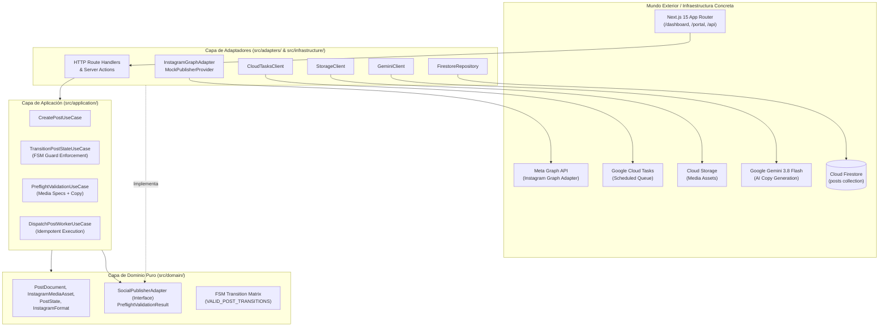

# 🌲 Árbol Canónico de Directorios y Fronteras Arquitecturales
**Social Ops Dashboard (v0.1.0 MVP Instagram-First)**  
**Autor:** Principal Software Architect (`software-architect`)  
**Fecha:** 2026-10-24 | **Estado:** Aprobado / Vigente

---

## 🏛️ 1. Filosofía Arquitectural: Hexagonal (Ports & Adapters) + Feature-First UI

Para garantizar escalabilidad, testabilidad al 100% y cero acoplamiento con plataformas de terceros (Meta, Google Cloud, Firebase), la estructura del proyecto sigue una arquitectura **Hexagonal (Ports & Adapters)** en el Core de la aplicación, complementada con organización **Feature-First** en la capa de componentes UI.



---

## 🌲 2. Árbol Canónico de Archivos y Directorios

```text
contentDashboardProgrammer/
├── .agents/                                # Definición y reglas de subagentes locales
│   ├── rules/                              # Reglas semánticas por tecnología/dominio
│   └── skills/                             # Skills instaladas bajo demanda desde el vault
├── docs/                                   # Documentación viva del sistema
│   ├── adr/                                # Architecture Decision Records (ADRs)
│   │   └── ADR-0001-ssot-firestore-fsm-cloudtasks-adapter.md
│   └── architecture/                       # Planos, diagramas y árboles canónicos
│       └── canonical-tree.md               # [Este documento]
├── src/
│   ├── domain/                             # 🟢 NÚCLEO: Dominio puro, agnóstico al framework
│   │   ├── adapters/                       # Contratos / Puertos de salida (Interfaces)
│   │   │   └── social-publisher.interface.ts # Puerto canónico para publicadores de redes
│   │   ├── models/                         # Entidades y tipos de datos puros
│   │   │   └── post.types.ts               # PostDocument, PostState, InstagramFormat, etc.
│   │   └── fsm/                            # Reglas de negocio de la FSM
│   │       ├── post-fsm.rules.ts           # Guardas transaccionales y validación de transición
│   │       └── post-fsm.transitions.ts     # Tabla y funciones puras de transición
│   │
│   ├── application/                        # 🟡 CASOS DE USO: Orquestación de la lógica
│   │   ├── dtos/                           # Objetos de transferencia de datos
│   │   │   ├── create-post.dto.ts
│   │   │   └── schedule-post.dto.ts
│   │   ├── use-cases/                      # Casos de uso atómicos (SRP)
│   │   │   ├── create-post.use-case.ts
│   │   │   ├── transition-post.use-case.ts
│   │   │   ├── schedule-post.use-case.ts
│   │   │   └── dispatch-post-worker.use-case.ts
│   │   └── validation/                     # Validadores de negocio pre-flight
│   │       ├── preflight-media.validator.ts # Dimensiones, ratios (1:1, 4:5, 9:16), duraciones
│   │       └── preflight-copy.validator.ts  # Límites de caracteres (2,200), conteo de hashtags
│   │
│   ├── infrastructure/                     # 🔵 INFRAESTRUCTURA: Clientes de servicios externos
│   │   ├── firebase/                       # Configuración y clientes de Firebase
│   │   │   ├── firebase-admin.config.ts    # Inicialización de Firebase Admin en servidor
│   │   │   ├── firestore.repository.ts     # Implementación concreta de repositorio en Firestore
│   │   │   └── storage.client.ts           # Generador de Signed URLs y subida a Cloud Storage
│   │   ├── cloud-tasks/                    # Integración con Google Cloud Tasks
│   │   │   └── cloud-tasks.client.ts       # Encolado, reprogramación y cancelación de tareas
│   │   └── ai/                             # Integración con Google Vertex AI / Gemini API
│   │       └── gemini.client.ts            # Cliente Gemini 3.8 Flash con esquemas estructurados
│   │
│   ├── adapters/                           # 🟣 ADAPTADORES DE SALIDA: Conexión con terceros
│   │   └── publishers/                     # Implementaciones de SocialPublisherAdapter
│   │       ├── instagram-graph.adapter.ts  # Adaptador real para Meta Graph API v0.1.0
│   │       ├── mock-publisher.provider.ts  # Proveedor simulado para Tests locales y CI/CD
│   │       └── publisher.factory.ts        # Inyector de dependencias según entorno (prod/dev)
│   │
│   ├── components/                         # 🟠 PRESENTACIÓN: Componentes UI (Feature-First)
│   │   ├── ui/                             # Primitivos reutilizables de UI (Shadcn base)
│   │   │   ├── button.tsx
│   │   │   ├── badge.tsx
│   │   │   ├── dialog.tsx
│   │   │   ├── input.tsx
│   │   │   └── textarea.tsx
│   │   ├── kanban/                         # Módulo de Tablero Kanban
│   │   │   ├── kanban-board.tsx            # Vista principal con columnas por PostState
│   │   │   ├── kanban-column.tsx           # Columna de estado con contador
│   │   │   └── kanban-card.tsx             # Tarjeta de post con miniaturas y badges
│   │   ├── calendar/                       # Módulo de Calendario Editorial
│   │   │   ├── editorial-calendar.tsx      # Matriz mensual / semanal
│   │   │   ├── calendar-day-cell.tsx       # Celda receptora de Drag & Drop
│   │   │   └── calendar-post-pill.tsx      # Píldora interactiva de post agendado
│   │   ├── table/                          # Módulo de Vista Tabular
│   │   │   ├── posts-table.tsx             # Tabla operativa de alta densidad
│   │   │   └── table-columns.tsx           # Definición de columnas, sorting y filtros
│   │   ├── drawer/                         # Módulo del Post Drawer Lateral
│   │   │   ├── post-drawer.tsx             # Contenedor split panel (Editor | Preview)
│   │   │   ├── post-editor-panel.tsx       # Formulario: título, brief, copy, hashtags
│   │   │   └── post-media-uploader.tsx     # Carga de medios con inspección pre-flight
│   │   ├── instagram-preview/              # Simulador fiel de feed de Instagram
│   │   │   ├── ig-feed-post-preview.tsx    # Simulación post 1:1 o 4:5 con avatar y caption
│   │   │   ├── ig-carousel-preview.tsx     # Carrusel interactivo con swipe/paginación
│   │   │   └── ig-reel-preview.tsx         # Reproductor de video vertical 9:16
│   │   └── client-portal/                  # Portal simplificado de aprobación para Cliente
│   │       ├── approval-banner.tsx         # Estado y acciones de 1 clic (Aprobar / Feedback)
│   │       └── feedback-modal.tsx          # Diálogo modal obligatorio para 'changes_requested'
│   │
│   ├── app/                                # 🔴 NEXT.JS 15 APP ROUTER: Rutas y Endpoints
│   │   ├── api/
│   │   │   ├── ai/
│   │   │   │   └── adapt-copy/
│   │   │   │       └── route.ts            # POST: Generación y adaptación de copy con Gemini 3.8
│   │   │   └── tasks/
│   │   │       └── dispatch-post/
│   │   │           └── route.ts            # POST: Endpoint del worker seguro de Cloud Tasks
│   │   ├── dashboard/                      # Panel del Community Manager (Kanban, Cal, Table)
│   │   │   ├── page.tsx
│   │   │   └── layout.tsx
│   │   ├── portal/
│   │   │   └── [clientId]/                 # Portal público autenticado para clientes
│   │   │       ├── page.tsx
│   │   │       └── layout.tsx
│   │   ├── globals.css                     # Estilos globales y tokens de diseño
│   │   ├── layout.tsx                      # Layout raíz HTML5
│   │   └── page.tsx                        # Redirección inteligente / landing inicial
│   │
│   └── lib/                                # Utilidades transversales
│       └── utils.ts                        # Helpers de clases Tailwind (cn), formato fechas
│
├── tests/                                  # Suite de Pruebas de Calidad
│   ├── unit/                               # Tests unitarios rápidos (Vitest)
│   │   ├── fsm.test.ts                     # Pruebas exhaustivas de la máquina de estados
│   │   └── preflight-validators.test.ts    # Pruebas de especificaciones de medios y copy
│   ├── integration/                        # Pruebas de integración de servicios y adaptadores
│   │   ├── cloud-tasks-dispatch.test.ts    # Encolado y cancelación de Cloud Tasks
│   │   └── instagram-graph-adapter.test.ts # Comprobación de contrato con MockProvider
│   └── e2e/                                # Pruebas End-to-End en navegador (Playwright)
│       ├── post-approval-flow.spec.ts      # Flujo CM crea -> Cliente aprueba -> Scheduled
│       └── rescheduling-flow.spec.ts       # Reprogramación Drag & Drop en calendario
│
├── .gitignore
├── next.config.ts
├── package.json
├── tailwind.config.ts
└── tsconfig.json
```

---

## 🛡️ 3. Reglas de Dependencias y Fronteras de Importación

| Capa | Ubicación | Importaciones Permitidas | Prohibiciones Terminantes |
| :--- | :--- | :--- | :--- |
| **Domain** | `src/domain/` | Ninguna externa. Solo tipos de TypeScript estándar (`string`, `number`, `Record`). | ❌ Prohibido importar `react`, `next`, Firebase SDKs, Axios, o librerías externas. |
| **Application** | `src/application/` | `src/domain/`, utilidades puras de validación. | ❌ Prohibido importar `src/infrastructure/`, `src/adapters/`, `src/components/`, `src/app/`. |
| **Adapters** | `src/adapters/` | `src/domain/`, SDKs externos específicos (ej. Meta SDK, Axios). | ❌ Prohibido importar `src/application/` (evita acoplamiento invertido), `src/components/`. |
| **Infrastructure** | `src/infrastructure/` | `src/domain/`, SDKs de infraestructura (`firebase-admin`, `@google-cloud/tasks`). | ❌ Prohibido importar `src/application/`, `src/components/`. |
| **Components (UI)** | `src/components/` | `src/domain/`, `src/application/` (hooks/DTOs), `lucide-react`, React/Tailwind. | ❌ Prohibido invocar directamente SDKs de infraestructura o `InstagramGraphAdapter`. |
| **App Router** | `src/app/` | `src/domain/`, `src/application/`, `src/components/`, `src/infrastructure/` (solo en server routes). | ❌ Prohibido colocar lógica de negocio o validaciones SQL/Firestore dentro de los archivos `page.tsx`. |

---

## 📏 4. Reglas de Higiene de Código y Anti-God Object

1. **Límite de Longitud por Archivo:**  
   Máximo **150–200 líneas de código**. Si un archivo excede este umbral, debe descomponerse en subcomponentes o módulos atómicos según SRP.
2. **Límite de Longitud por Función:**  
   Máximo **25–30 líneas**. Máximo **3 niveles de anidamiento** (*early return pattern* obligatorio).
3. **Comentarios Justificados:**  
   Solo documentar el **"Por qué"** de decisiones no evidentes. Prohibido comentar obviedades del "Cómo".
4. **Cero `any`:**  
   Tipado TypeScript estricto (`strict: true` en `tsconfig.json`). Todo payload externo debe validarse en tiempo de ejecución con esquemas tipados.
